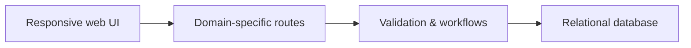

# SupportDesk SaaS

**Customer Support** · Node.js · Express · SQLite · Portfolio case study

> Ticket intake and triage dashboard for a small support team.

### At a glance

| | |
| --- | --- |
| **Core workflow** | Agents → tickets → assignment → notes → resolution |
| **Highlights** | Ticket priorities, queue filtering, internal notes, agent assignment |
| **Persistence** | Local SQLite database |
| **Maturity** | Functional portfolio MVP — not production hardened |


## Engineering edition: measurable behaviour

- **Live read-only reporting:** `GET /api/insights` derives aggregates from stored business data (not hard-coded numbers).
- **Review path:** [Five-minute walkthrough](docs/DEMO.md) · [API reference](docs/API.md) · [Engineering decisions](docs/ENGINEERING.md).
- **License:** MIT. **Operational maturity:** local educational MVP, not an internet-facing production service.
- **Container:** `docker compose up --build` binds the demo to `127.0.0.1` and stores its SQLite file in a persistent named volume.

## Product capabilities

- Submit customer tickets with category and description
- Filter by ticket status and priority
- Assign tickets to support agents
- Add internal timeline notes and resolve tickets

## Architecture



### Design decisions

- **Domain-specific modelling:** the entities and routes reflect a real customer support workflow rather than generic records.
- **Portable setup:** the application can be run locally with documented tooling; no paid external API keys are required.
- **Explicit boundaries:** this is a demonstrable MVP. Auth, tenancy, logging, scalability and operational security need additional engineering before production use.

## Local development

```bash
npm install
npm start
```
Open http://localhost:3000. Set `PORT` to use another port.

## Tests

```bash
npm install
npm test
npm start
```

The GitHub Actions workflow runs integration tests of real API behaviour. These tests cover representative workflows and validations; they do not imply comprehensive security or load testing.

## API and UX

The project provides a browser-based demo with JSON API endpoints. See the application source for concrete endpoints. No hosted demo is claimed.

## Roadmap

- SLA clocks; outbound email notifications.
- Authentication, authorisation, secure secrets management, and deployment configuration.
- Database migrations and backups where not already available, along with comprehensive accessibility and end-to-end testing.

## Security and scope

Local demonstration only; do not deploy publicly with real customer data as-is. The `.env.example` documents configuration; do not commit `.env`, credential files, database files, or third-party API keys. See [SECURITY.md](SECURITY.md).

## Project maintenance

- [CONTRIBUTING.md](CONTRIBUTING.md) — development conventions and review expectations
- [.github/workflows/checks.yml](.github/workflows/checks.yml) — automated checks
- [CHANGELOG.md](CHANGELOG.md) — release notes
